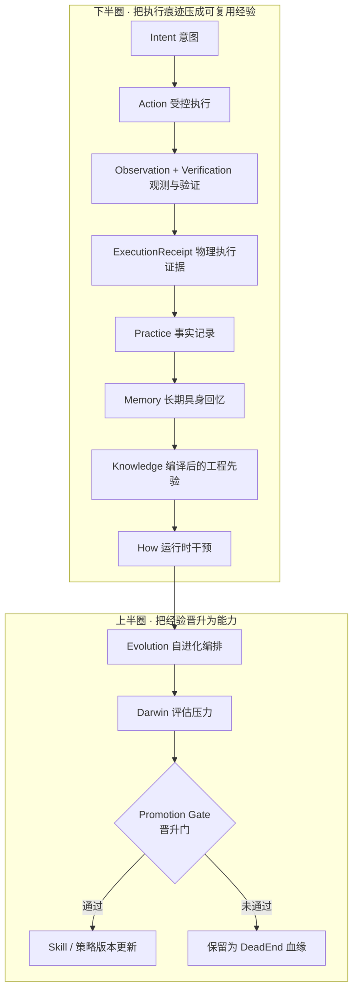
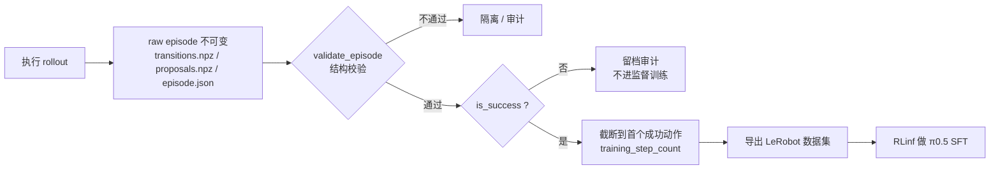
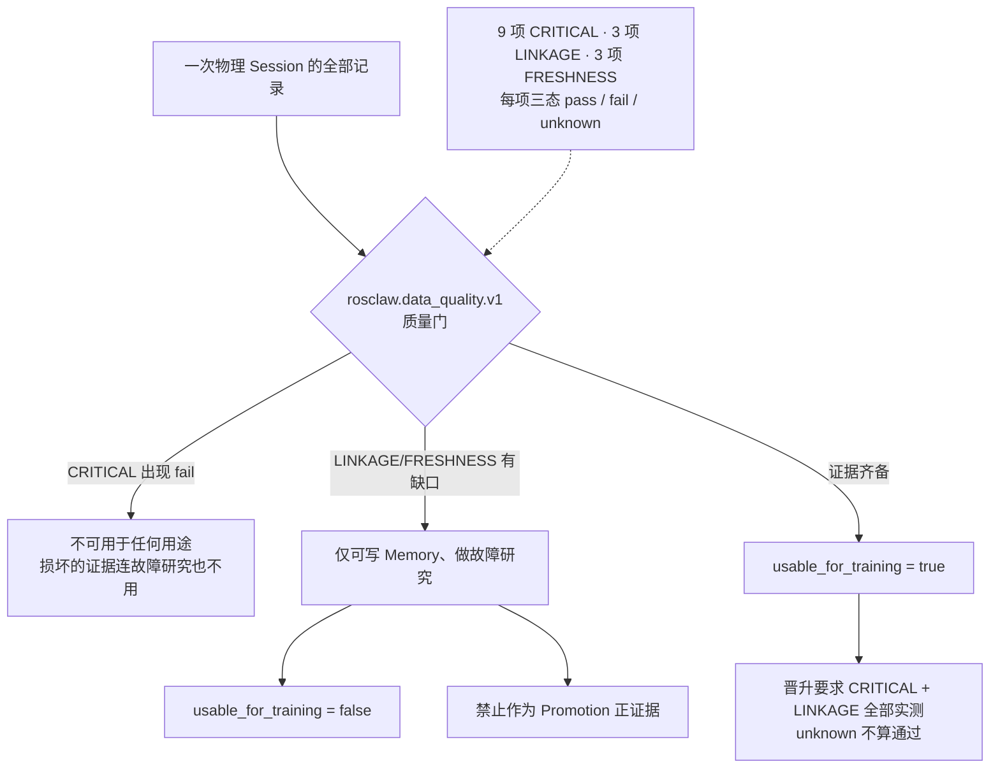

# 引言：同一句指令，两个数字

先看一组数字。同一份冻结的 π0.5-SFT 权重 π_RLinf，在标准 LIBERO 上拿到 **95.3%** 成功率；换到加了扰动的 LIBERO-PRO 上，掉到 **50.0%**。官方文档写得很直白：「π_RLinf achieves 95.3% success on standard LIBERO but drops to 50.0% on LIBERO-PRO under perturbations.」（[Harness VLA 资源页](https://rpent.readthedocs.io/en/latest/rst_source/resources/harnessvla.html)）

更要命的是失败的**形态**。论文 §3.3 记录了两个具体场景：在指令被重定向的任务里，场景视觉几乎没变，只是目标换了，模型「repeats the standard behavior instead of following the new task description」；在物体布局被交换的任务里，模型「still moves the object toward the training-time region」。换句话说，它没有失败在手上，失败在**它以为自己在做什么**。

这就是具身智能与一般软件系统最本质的分野：在物理世界里，「接口返回成功」与「任务真的完成」是两件事，而「同一句指令、同一个模型、同一个 prompt」两次执行可以给出不同结果。这些差异不是噪声，是**信号**——但只有把执行过程按结构留下来、判断过、并真的用它改过策略，它们才算信号。

本文围绕三个问题展开：

1. **为什么要实现具身数据闭环**：为什么「工作一天」不等于「成长一天」，缺口具体在哪里；
2. **业界怎么实现**：以 ROSClaw 的 Data Flywheel 与 RPent / Harness VLA 两条主干为骨架，对照学术界与工业界方案；
3. **需要什么数据**：从原始日志到可复用记忆的层级结构、证据与解释的分离、质量门与三种用途资格、以及落到 LeRobot / RLDS 这些格式上长什么样。

## 先交代证据等级：这篇文字里哪些能信到什么程度

具身数据闭环是营销重灾区。写这一篇最费劲的不是找材料，而是分清「谁说的」，所以读法先摆出来：

| 证据等级 | 含义 | 本文中的典型对象 |
|---|---|---|
| **T1 论文实测** | 论文表格/正文给出的数字，可定位到表号 | Harness VLA 的 LIBERO-Pro / RoboCasa365 / RoboTwin C2R 结果 |
| **T1 代码实证** | 仓库源码文件 + 行号，可点开逐行核对 | `rpent/flywheel/episode.py`、`src/rosclaw/practice/data_quality.py` |
| **T2 官方文档 / 官方页面** | 官方文档、官方 leaderboard、HF 数据集卡 | `rpent.readthedocs.io`、`robocasa.ai/leaderboard.html` |
| **T3 官方博客 / 企业叙事** | 公司官方博客与新闻页，有机制无第三方复现 | Waymo 的 data flywheel 篇、Figure Index |
| **T4 二手 / 不可访问** | 只有搜索索引、原文拿不到 | 两篇微信文章、Tesla AI Day 逐字稿 |

需要提前说明三点：第一，本文引用的两篇微信文章（《机器人一次任务，到底应该留下什么？》与《为什么机器人需要数据闭环？ROSClaw 是如何做的》）**原文无法公开访问**（`mp.weixin.qq.com` 反爬，多组关键词零命中），凡只在这两篇里出现的说法一律标注「未证实」，并尽量改用 ROSClaw 的一手文档与源码替代。第二，**全行业没有一手来源发布过「部署数据回流 → 能力提升 X%」的严格量化**——能找到的数字全是「数据规模 / 数据混合」消融，不是回流收益，下文会逐处降级措辞。第三，代码佐证给到文件 + 行号，论文给到表号，方便直接点开打假。

---

# 一、为什么要实现具身数据闭环

## 1.1 「工作一天」与「成长一天」之间的结构性缺口

一台机器人在实验室跑了一天，默认产出是什么？一串 observation、action、reward、terminal flag 的时间序列——**日志**。日志不是资产，理由很朴素：它记录「发生了什么」，而能力需要的是「什么条件下该做什么、什么条件下不能做什么」。

ROSClaw 把这件事写成了信条，而且写得很硬：「**请求不等于执行，分发不等于完成，完成必须有证据。**」以及「它的统一动作路径把意图绑定到 Body 和 Capability，执行策略与授权检查，仲裁物理资源，向 Driver 分发，并返回**带证据等级**的 `ExecutionReceipt`。Memory 与技能演化路径异步消费、评估这些证据，**不能代替执行证据**。」（[ROSClaw README.zh.md](https://github.com/ros-claw/rosclaw/blob/main/README.zh.md)）

为什么这条看似啰嗦的信条是整套系统的地基？因为它回答了一个必须先回答的问题：**在物理世界里，「完成」的判定权归谁。** 如果这个判定权落在应用层的 ACK 上，那你的数据管线从第一天起就在采集错的标签——所有下游的记忆、检索、晋升都建立在一个假前提上。ROSClaw 在能力表里给了一个非常具体的反例：loopback 故障测试证明「目标附近回读只能标为 `DELIVERY_INFERRED` 而非协议 ACK」（[README 能力边界 L105](https://github.com/ros-claw/rosclaw/blob/main/README.md#L105)）。回读到了不等于送到了，这不是严谨癖，这是**标签正确性问题**。

所以「工作一天 ≠ 成长一天」的缺口不在数据量，而在缺了一道**认知压缩**：把原始执行痕迹逐级压成「下次可复用的判断」。压不上去，采多少条都不算数。

## 1.2 数据飞轮的上下半圈：闭环不是「一个 memory 模块」

ROSClaw 公开了一份完整的数据飞轮文档，把每层的所有权与数据流逐层摊开（[docs/DATA_FLYWHEEL.md](https://github.com/ros-claw/rosclaw/blob/main/docs/DATA_FLYWHEEL.md)）。它的六层定义值得逐字抄下来：

| 层 | 定位 | 回答的问题 |
|---|---|---|
| Practice | 事实记录 | 发生了什么 |
| Memory | 长期具身回忆 | 应该记住什么 |
| Knowledge | 编译后的工程先验 | 可以泛化出什么 |
| How | 运行时干预 | 当前应该怎么修 |
| Evolution | 自进化编排 | 应该尝试改变什么 |
| Darwin | 评估压力 | 改变究竟好不好 |

这六层可以理解成一架飞轮的上下两个半圈。**下半圈**把执行痕迹压成可复用的经验：受控执行 → 观测与验证 → `ExecutionReceipt` → Practice 事实记录 → Memory → Knowledge → How。**上半圈**则把经验晋升为能力：Evolution 编排尝试 → Darwin 施加评估压力 → 晋升门（Promotion Gate）判定 → 通过的变更新策略与技能版本，没通过的留成血缘上的死胡同。



*图 1 · ROSClaw 数据飞轮的上下半圈。分层命名与顺序取自 [docs/DATA_FLYWHEEL.md](https://github.com/ros-claw/rosclaw/blob/main/docs/DATA_FLYWHEEL.md) 的「飞轮全图」节。晋升通过的 `Skill / 策略版本更新` 会回到执行侧成为下一轮起点——这条回边已在图中省略。*

这里有处措辞分歧：需求书与两篇微信文里讲的是「控制闭环 / Agent 闭环 / 数据闭环」**三个**闭环，但 ROSClaw 官方的一手表述是「一个运行时，**两个**闭环」——一张表的两个方向：左列「意图 → 本体 → 能力 → 权限 → 执行」，右列「观测 → 验证 → 实践 → 记忆 → 技能 → 进化」，另有 `ARCHITECTURE.md` 里的 `Execution Loop` 与 `Self-Evolution Loop`（[README.zh.md](https://github.com/ros-claw/rosclaw/blob/main/README.zh.md)、[ARCHITECTURE.md](https://github.com/ros-claw/rosclaw/blob/main/ARCHITECTURE.md)）。「三闭环」在 ROSClaw 全库零命中，属于需求书的再表述而非官方框架。**这不是抠字眼**：照「三个闭环」拆系统边界会拆错模块归属；官方口径里「执行由运行时治理；实践、记忆与技能改进建立在记录和验证的结果上，变更仍需评估与晋升」才是真正的分层约束。

飞轮还配了一条 16 级血缘链，把「一次动作」与「一个技能版本」连起来：「trace_id → action_id → receipt_id → practice_id → session_id → episode_id → evidence_id → memory_id → reference_pack_id → advice_id → proposal_id → patch_id → experiment_id → evaluation_id → champion_id → skill_version」（[docs/DATA_FLYWHEEL.md L99-102](https://github.com/ros-claw/rosclaw/blob/main/docs/DATA_FLYWHEEL.md#L99-L102)）。这条链的工程价值在于：当某个技能版本出问题时，你可以**反查**到它是被哪几次真实执行证据推上去的。

## 1.3 物理世界的「同指令不同结果」：分布漂移的四种形态

抽象地说「分布漂移」没用，得看它长什么样。Harness VLA 论文把失败拆成了四类可观察的形态，每一类都有实证：

**第一，语义重定向。** 场景视觉几乎不变，目标变了。论文 §3.3 的 Key Finding 1 写得很清楚：模型「repeats the standard behavior instead of following the new task description」（[arXiv:2607.08448v5](https://arxiv.org/html/2607.08448v5)）。这正是 LIBERO-Pro 的 `k=L`（instruction perturbation）要打的点：「Instruction perturbation includes both semantic- and task-level variations.」（[LIBERO-Pro 论文 §4.1](https://arxiv.org/html/2510.03827v2)）

**第二，目标重绑定（布局漂移）。** 物体没换，位置换了。论文 Key Finding 1 的另一半：模型「still moves the object toward the training-time region」。对应的官方扰动是 `k=R`：「Initial configuration perturbation alters the absolute and relative positions of objects while maintaining physical plausibility.」

**第三，环境与外观扰动。** 背景、光照、纹理变了——`k=E`：「modifies the visual environment context, such as background, lighting, or texture, without altering task feasibility.」以及物体非本质属性变化 `k=O`。

**第四，接触阶段的物理脆性。** 这一条最容易在基准里被掩盖。论文 Key Finding 2 承认：「Because VLA execution is stochastic and short-horizon contact is physically brittle, a single failed attempt need not terminate the entire rollout.」一次抓空不代表策略错了。

这四类形态的量级有多严重？LIBERO-Pro 论文摘要给了一句很不客气的话：现有模型在标准 LIBERO 上能超过 90%，「their performance collapses to 0.0% under our generalized setting」。官方 README 徽章上的分解更细：OpenVLA 0.98 → 0.0 / 0.0，π0 0.92 → 0.0 / 0.0，π0.5 0.97 → 0.0 / 0.4，UniVLA 0.89 → 0.0 / 0.1（Original / +P1 任务扰动 / +P2 位置扰动）（[LIBERO-PRO 仓库](https://github.com/Zxy-MLlab/LIBERO-PRO)）。在 Harness VLA 论文自己的 Table 3 里，同一张表上 π0 只有 0.3%、π0.5 11.0%、X-VLA 3.8%（官方榜单上 MolmoAct 也只有 1.5%）。

⚠️ 一处命名陷阱：Harness VLA 论文把 LIBERO-Pro 的扰动简写成 `T`（instruction-redirection）与 `S`（position-swap），但 LIBERO-Pro 官方标签是 `+ P1: Task Perturbation` 与 `+ P2: Position Perturbation`；「instruction-redirection」「position-swap」在官方论文、README 与 `perturbation.py` 里**都查不到逐字出处**。引用时要么写论文的 T/S 并注明是论文改写，要么写官方的 P1/P2。

## 1.4 不闭环的代价：先有判据，再谈数据量

「不闭环的代价」最常见的错误讲法是「用旧数据训练所以效果差」。这句话无法证伪，也无法指导工程。真正可操作的是先立一个**观察口径**。

这里必须坦白一件事：需求书里提到的 **Failure Recurrence Rate（同类任务上同一失败的重复出现率）在公开一手来源里查不到任何公式、阈值或实测数字**。在 `RLinf/RPent` 与 `ros-claw/rosclaw` 两个仓库全量检索中，「Failure Recurrence」/`failure_recurrence` 均零命中；ROSClaw 里唯一近名的东西是 `src/rosclaw/evolution/hardware/recurrence.py` 与 CLI 的 `recurrence` 子命令，描述为「Phase 8: auto-apply the promoted rule on recurrence」——那是「复发时自动应用已晋升规则」的**动作**，不是「重复失败率」的**度量**。⚠️ 引文归属要写准：这句逐字来自 CLI 子命令 help 文案（[cli.py L8360](https://github.com/ros-claw/rosclaw/blob/main/src/rosclaw/cli.py#L8360)），不在 `recurrence.py` 里——该文件 docstring 是「Recurrence — the self-evolution proof (PR-EVO-HW-5, 真机自进化v2 §Phase 8)」（[recurrence.py L1-20](https://github.com/ros-claw/rosclaw/blob/main/src/rosclaw/evolution/hardware/recurrence.py#L1-L20)）。

所以要在团队里推这个指标，正确说法是：「Failure Recurrence Rate 是我们的观察口径，无现成一手来源。」**不要给它编数字**——闭环的收益最容易用「失败率下降了 30%」这种没人能核的话糊过去。

在没有这个指标之前，可用的替代观察有三类，且都有实证支撑：

- **重试结构**：执行允许的失败重试是有限的、被显式编码的。Harness VLA 的 Appendix G 写「Execution allows at most three grasp attempts, skips dependent transport after an unconfirmed grasp, and stops if a required anchor cannot be localized.」——一个不闭环的系统里，这类「重试预算」往往写死在控制脚本里，从不回看。
- **退化幅度**：像 95.3% → 50.0% 这样的对照，是「不闭环」最便宜的证据：同一权重、同一 prompt、只换扰动条件。
- **事后最优的诱惑**：Flash Mode 在 LIBERO-Pro 上报了 72.63%（581/800），但论文自己拆台：「One card c*_τ is fixed across all seeds of task τ. The same seeds are used for selection and reporting: Flash Mode (max) is therefore a retrospective best-card result, not an independent held-out evaluation, and can be optimistic relative to fresh layouts.」**如果你用「同批 seed 上挑最好」来汇报闭环收益，你就是在自己骗自己。**

---

# 二、需要什么数据：从日志到记忆的认知压缩

这一节回答「传什么数据」。先说核心结论：**数据有门槛，不是越多越好；而门槛必须先落到结构上。**

## 2.1 层级结构：五级链是本文的归纳，一手对照是六级

需求书给出的层级是「Log → Event → Episode → Experience → Memory」。必须如实说明：**这套精确的五级链在任何一手来源里都找不到逐字出处**。在 ROSClaw 仓库全树检索（`压缩|compress|Episode.*Experience|Log.*Event.*Episode`）与 arXiv / 官方博客中都未命中。

能引的两条一手对照是：

- **ROSClaw 的两条链路**：「Intent → Body → Capability → Authority → Action」与「Observation → Verification → Episode → Memory → Skill → Evolution」；中文版「意图 → 本体 → 能力 → 权限 → 执行」「观测 → 验证 → 实践 → 记忆 → 技能 → 进化」（[README.md](https://github.com/ros-claw/rosclaw/blob/main/README.md)、[README.zh.md](https://github.com/ros-claw/rosclaw/blob/main/README.zh.md)）。
- **RPent 的三层记忆**：Global Memory（跨任务通用规则与失败模式，作用于全任务）／Task-family Memory（族内验证过的策略与注意事项，作用于相似任务）／Task-specific Memory（单次任务运行的记录与流程，仅当前任务参照）（[Memory Design](https://rpent.readthedocs.io/en/latest/rst_source/development/memory.html)）。

值得写进工程规范的不是「有几级」，而是**每一级的判别标准**。用第一性视角压一遍：

**原始轨迹（raw episode）** —— 判据是「可回放、不可改写」。RPent 的飞轮文档把这一点写成了硬约束：「It stores immutable raw episodes; conversion to a training format is a separate step.」并且「The exporter never rewrites the raw episodes.」落盘实现上，每个 episode 是一个目录，含 `transitions.npz` / `proposals.npz` / `episode.json`；写入先落 `.partial` 目录，校验通过后 `os.replace` 原子发布（`rpent/flywheel/episode.py` L213）——**原子性不是洁癖**，它保证了「磁盘上存在的 episode」一定是完整的 episode。

**Episode** —— 判据是「有明确的边界信号与成功判定」。反例：把一次 rollout 的整个 session 直接当 episode 存下来（中途重置过三次），那么这条数据的 `is_success` 无意义，训练时的信用分配全错。RPent 的 schema 用 `stop_reason ∈ {env_terminated, env_truncated, agent_stopped}` 与 `is_success` 把边界与结果显式化（`episode.py` L194-208）。

**Experience / Memory** —— 判据是「有复用范围与前提条件」。RPent 的记忆纪律写得很具体：「Apply a note only when its prerequisites and evidence limits match the current task.」以及权限分层：「evaluation uses read-only access, while exploration allows writes to the current cell's inbox.」（[Memory and Exploration](https://rpent.readthedocs.io/en/latest/rst_source/guides/memory.html)）反例：把某次任务的「抓这个碗」写成全局规则——它会在下一个任务里变成一个错误的先验。

> 「Episode 八维度」这个说法同样**未证实**：原文不可访问，且 ROSClaw 代码/文档里没有「八维」式的 Episode 定义（它枚举的是 9 类 Memory：`episodic · failure · intervention · procedural · body · spatial · skill · sim2real · human_feedback`，见 [docs/DATA_FLYWHEEL.md L32-34](https://github.com/ros-claw/rosclaw/blob/main/docs/DATA_FLYWHEEL.md#L32-L34)）。下面 2.2 改用可实证的字段清单替代。

## 2.2 数据飞轮的出口：一个可运行的完整链路

理论讲完，看唯一一处**代码级的闭环落地证据**：RPent Flywheel。它的定位很克制——「The optional Flywheel records executed LIBERO evaluation trajectories without changing the planner or action primitives.」，采集是 opt-in 且只支持评测模式（[Data Flywheel](https://rpent.readthedocs.io/en/latest/rst_source/guides/flywheel.html)）。

完整命令链（可直接跑）：

```bash
# 1) 采集：跑评测并把 episode 落盘
rpent --robot libero --suite libero_goal --task 0 --seed 0 \
  --planner codex --collect-flywheel-data --flywheel-root /path/to/datacollection

# 2) 校验：结构级校验（注意它只检查结构，不检查任务是否真的成功）
rpent-flywheel validate /path/to/raw/episode

# 3) 导出：只导出成功前缀，转成 LeRobot 数据集
rpent-flywheel export-lerobot --data-root /path/to/datacollection \
  --suite libero_goal --task 0 --dataset-id goal-task-00 --output-root /path/to/lerobot
```

那条导出命令里藏着整个飞轮最关键的设计决策，文档逐字写了两条：「For each successful episode, the exporter includes all executed actions from the start through the first action that achieves task success… Actions after the first success are excluded.」与「Failed episodes remain available for auditing but are not included in this supervised-training export.」

翻译成工艺术语：**「哪一段轨迹算正样本」被写进了代码**。第一次成功之后的动作不进监督训练（那些动作是成功之后的收尾甚至随机探索，当正样本会污染策略）；失败的 episode 不删，但只供审计。导出后还会重开 LeRobot 数据集核对帧数，不一致就抛错（`rpent/flywheel/export.py` L127-129）。



*图 2 · 从原始 episode 到可训练数据集。字段与截断规则见 [rpent/flywheel/episode.py L55-215](https://github.com/RLinf/RPent/blob/main/rpent/flywheel/episode.py#L55-L215) 与 [export.py L66-143](https://github.com/RLinf/RPent/blob/main/rpent/flywheel/export.py#L66-L143)。注意职责切分：RPent 只负责采集与导出，「RLinf handles model training, logging, and checkpoint saving.」*

顺便说一句**这条链没有做的事**：全库检索中 `quality_gate` / `receipt` / `promotion` 零命中，`rpent-memory validate` 的原话是「checks file structure, not real task success.」，记忆对外发布靠维护者人工审核（「The repository has no automatic memory-upload entry point.」）。RPent 的飞轮是一台**采集与导出机器**，质量门与晋升机制在它这里不存在（[Memory Design](https://rpent.readthedocs.io/en/latest/rst_source/development/memory.html)）。

## 2.3 Evidence 与 Interpretation 必须分开存

这是整套体系里最容易被跳过、但后果最严重的一条：**客观执行痕迹（Evidence）与对它给出的解释（Interpretation）必须分开存储、分别可追溯。**

`ExecutionReceipt` 是 ROSClaw 冻结的规范术语，定义在 ADR-0010 里：「物理执行证据 ｜ **ExecutionReceipt** ｜ 真实执行发生到了哪一步」（[ADR-0010](https://github.com/ros-claw/rosclaw/blob/main/docs/adr/0010-canonical-vocabulary.md)）。执行链的官方描述是：「8. Observation and task verification produce a durable ExecutionReceipt. / 9. Practice, Memory, Know, How, Auto, and Darwin consume receipts asynchronously.」（[ARCHITECTURE.md](https://github.com/ros-claw/rosclaw/blob/main/ARCHITECTURE.md)）

它到底存了什么？看仓库里一份真实的 receipt JSON（`schema_version = "rosclaw.receipt.v1"`）字段清单，能看清「证据」与「解释」是怎么被切开放在同一份记录里的：

- 身份与血缘：`action_id`、`trace_id`、`body_id`、`body_snapshot_hash`、`capability_id`
- 治理决策：`policy_decision`、`authorization_decision`、`resource_lease{lease_id, resource_id, acquired_at, exclusive}`
- 执行事实：`simulation_result`、`dispatch_result{accepted}`、`driver_ack`、`acknowledgement_stage`、`observations`、`final_state`、`transitions[]`
- **判定与分级**：`evidence_level`、`evidence_domain`、`verified`、`valid_for_promotion`、`trust_level`、`usable_for_real_execution`
- 复核产物：`verification_result{mission_verification_artifact, success, memory_id, memory_outcome}`
- 出错信息：`errors`

注意 `dispatch_result.accepted` 与 `driver_ack` 是**事实**，`verified` 与 `evidence_level` 是**分级判断**，两者同时存在但不互相覆盖。官方对此的表述是：「Acknowledgement removes the recovery gate only. It does not rewrite the unknown receipt, clear the Runtime E-Stop latch, or prove a physical stop.」（[docs/ROSCLAWD.md L240-241](https://github.com/ros-claw/rosclaw/blob/main/docs/ROSCLAWD.md#L240-L241)）——**收到 ACK 只解除重试门，不改写「物理结果未知」这条证据。**

为什么这条这么重要？给一个具体的假成功 / 假失败场景：

- **假成功**：驱动器返回「指令已下发」，运行时就把任务标成成功，这条轨迹被推进训练集——而物理上物体没动。你往数据集里灌了一条**坏的正样本**，还是被自己判定为高质量放进来的。
- **假失败**：机械手实际抓稳了，但成功判据读到的「视觉接近度」不够，任务被判失败，这条轨迹被降级成审计数据——**你丢掉了一条好数据**；若失败标签还用来训练失败模型，你得到的是一个错的失败模型。

真机侧的现实更朴素：论文 §4.1 明确写了「Real-world resets and success judgments require a human in the loop… Task success is recorded only after an operator inspects the current scene and confirms that the task goal has been achieved.」，而且真机实验「provide qualitative demonstrations rather than comparative success-rate estimates」——**真机没有自动的成功判定，也没有可引用的成功率数字**。论文 Appendix C 还补了一句边界：「Primitive-level post-conditions, such as the return condition of vla_act or release, only determine when an individual primitive returns control to the planner; they are not used as substitutes for the final task success predicate.」——primitive 的返回值不能当任务成功的替代品。

外部对照：把人类纠错纳入训练回路，最早被算法化的是 DAgger——**这是 2011 年的历史源头工作，属「理论先导」，不是现行标准方案**：它给出的是「人类介入能打破错误累积」的性能上界，不是今天可部署的数据管线。其 Theorem 2.1（Ross and Bagnell, 2010）：给定 `E_{s~d_π*}[ℓ(s,π)] = ε`，则 **`J(π) ≤ J(π*) + T²ε`**，误差随时域 `T` **二次**增长，这正是「compounding errors」的出处；Theorem 3.2 是有限样本版 `J(π̂) ≤ J(π*) + uTε_N + O(1)`（[Ross et al., AISTATS 2011](https://proceedings.mlr.press/v15/ross11a/ross11a.pdf)）。但 DAgger 处理的是「策略分布上的错误累积」，**不提供**「无人监督的物理成功判定」，两者常被混为一谈。

## 2.4 Data Quality Gate：三种用途资格，以及「unknown 不等于 pass」

数据集校验工具到处都是，但绝大多数只做一件事：**schema 一致性**。ROSClaw 的 Data Quality Gate 做的是另一件事：**给同一份数据发放不同用途的资格**。

源码在 `src/rosclaw/practice/data_quality.py`，模块 docstring 逐字：

> "Data Quality Gate for physical sessions (Physical Evolution Lab §6.3). Runs before Distill / Train / Promotion: a session must EARN each use. Three-state honesty per check: `pass` — measured and within contract; `fail` — measured and violated; `unknown` — the session never recorded what this check needs (unmeasurable is disclosed in `missing_ranges`, never silently treated as pass). The gate is READ-ONLY: it never modifies sessions, manifests, or stores."

三态判定是这套设计的灵魂：「这一项没测到」在多数工具里被当成「通过」或忽略，这里强制标为 `unknown` 并写进 `missing_ranges`。检查项分三级（L42-55）：9 项 CRITICAL（`rgb_completeness`、`depth_completeness`、`rh56_state_completeness`、`timestamp_monotonicity`、`duplicate_event_ids`、`nan_inf`、`frame_reuse`、`body_hash_consistency`、`policy_version_switch`）、3 项 LINKAGE（`receipt_linkage`、`trace_linkage`、`missing_artifacts`）、3 项 FRESHNESS（`camera_hand_alignment_skew`、`rgb_depth_skew`、`stale_observation`），并且 `PROMOTION_MUST_MEASURE = CRITICAL_CHECKS | LINKAGE_CHECKS`。

判定语义（L36-41 逐字）决定了三种用途资格：

> "CRITICAL — the session's basic integrity is broken; unusable for anything (not even failure research needs corrupted evidence)."
> "LINKAGE/FRESHNESS — evidence gaps that block training and promotion but still allow memory/failure research（§6.3: 低质量 Session 可以用于故障研究、写 Failure Memory、禁止用于训练、禁止作为 Promotion Positive Evidence）."



*图 3 · 三种用途资格与晋升门。语义取自 [data_quality.py L36-41](https://github.com/ros-claw/rosclaw/blob/main/src/rosclaw/practice/data_quality.py) 与 L71-86 的输出契约（`passed / usable_for_memory / usable_for_training / usable_for_promotion / reasons / missing_ranges / degraded_sensors / checks / gate_version`）。阈值 `DEFAULT_MAX_CAMERA_HAND_SKEW_MS = 500.0`、`DEFAULT_MAX_STALE_FRAME_AGE_S = 0.5` 在源码里被标注为「principled, not tuned-to-pass」且给了推导（当前语料手部遥测约 2.4 Hz，500ms 约为最近邻对齐下界的 2.4 倍）。*

**「数据脏」在这条管线里不是卫生问题，是安全问题。** 坏数据进 Memory 会污染检索，进训练会放大坏策略，当晋升正证据会让技能版本记住一个从未发生的成功。

**这是独创还是通行做法的重命名？** 调研给出的判定是：**实质性扩展**。LeRobot 侧的校验是「结构性 raise」——`aggregate.py` 的 `validate_all_metadata()` 在 fps/robot_type/features 不一致时抛 `ValueError`，`dataset_tools.py` L377-379 规定 `timestamp / frame_index / episode_index / index / task_index` 不可删除，v3 还强制要求 `dataset.finalize()`（[aggregate.py](https://github.com/huggingface/lerobot/blob/main/src/lerobot/datasets/aggregate.py)、[dataset_tools.py](https://github.com/huggingface/lerobot/blob/main/src/lerobot/datasets/dataset_tools.py)）；RLDS 的约束是「Although some fields of the steps are optional, all the steps in the same dataset are required to have the same fields.」（[RLDS dataset format](https://github.com/google-research/rlds#dataset-format)）；OXE 的目标是格式统一（[open_x_embodiment](https://github.com/google-deepmind/open_x_embodiment)）。它们**都不区分用途资格**，也没有「unknown ≠ pass」这一层。

不过要给出边界：这套 Gate 的**基线检查项**（完整性、时间戳单调、重复 ID、NaN、血缘链接）与 LeRobot / RLDS 同类，它扩展的是**判定的出口**（用途资格 + 三态诚实 + 晋升必须实测），不是检查本身。另外，`usable_for_memory / usable_for_training / usable_for_promotion` 这套公开先例在公开检索里零结果，最接近的只有 RLDS 的 `is_valid_rlds_dataset`（合法/丢弃二分）与 HF dataset card 上 intended-use 的文字声明——那些都不是可执行的用途分级。

## 2.5 落到格式上：Episode 到底长什么样

层级讲完必须落地，否则没法写采集脚本。四套可实证的字段集：

| 来源 | 可实证的字段枚举 | 定位 |
|---|---|---|
| **RPent Flywheel episode（实际落盘）** | `observations`（各键）· `actions` · `rewards` · `terminated` · `truncated` · `action_source` · `primitive_id` · `vla_chunk_id` · `proposal_index`；元数据 `is_success` · `stop_reason` · `step_count` · `training_step_count` · `primitive_names` · `proposal_count` | [episode.py L156-208](https://github.com/RLinf/RPent/blob/main/rpent/flywheel/episode.py#L55-L215) |
| **ROSClaw Practice / Evidence** | `episode` · `praxis_event` · `failure` · `telemetry metadata` · `receipt` · `critic_result` · `artifact pointer` · `hash` | [DATA_FLYWHEEL.md L25-27](https://github.com/ros-claw/rosclaw/blob/main/docs/DATA_FLYWHEEL.md#L25-L27) |
| **RLDS / OXE** | Step 必填 `is_first` `is_last`；可选 `observation` `action` `reward` `is_terminal` `discount`；Episode 可选 `episode_id` `agent_id` `environment_config` `experiment_id` `invalid` | [RLDS dataset format](https://github.com/google-research/rlds#dataset-format) |
| **LeRobot v3 帧级必备** | `timestamp` `frame_index` `episode_index` `index` `task_index`（不可删除） | [dataset_tools.py L377-379](https://github.com/huggingface/lerobot/blob/main/src/lerobot/datasets/dataset_tools.py) |

把这几套对齐一下，能看出**互补的缺口**：

- **重合**：episode 边界（RLDS `is_first/is_last` ↔ RPent `stop_reason` ↔ LeRobot `episode_index`）、动作与观测、终态标记。
- **RPent 有而通用格式没有**：`primitive_id`、`vla_chunk_id`、`proposal_index`、`action_source`。这一组把「这条动作是脚本出的还是 VLA 出的、属于哪个 primitive 的第几次提案」变成**结构化字段**——在「数据资格判定」里这是关键，因为你可能希望「脚本动作可以进训练，未验证的 VLA 探索动作只能进记忆」。
- **ROSClaw 有而通用格式没有**：`receipt`、`critic_result`、`artifact pointer`、`hash`——**证据与血缘字段**。没有它们，你无法回答「这条数据凭什么算成功」。
- **通用格式有而 RPent 没有**：`discount`、跨数据集统一 schema 约束。

格式层面另一件事是版本与哈希：RPent-memory 每个版本目录带 `manifest.json`，登记发布文件的 SHA-256，loader 会校验映射（[Memory and Exploration](https://rpent.readthedocs.io/en/latest/rst_source/guides/memory.html)）。**记忆是有版本的**——一次评测必须声明用了哪一版。

LeRobot 侧有个很实际的坑：v3 从「一 episode 一文件」改成「多 episode 共用一个 Parquet/MP4 分片」，episode 边界改由元数据解析（「Episode boundaries and lookups are resolved through metadata, not filenames.」），且「Without calling `finalize()`, your parquet files will be incomplete and the dataset won't load properly.」；v2.1 的 `data/chunk-000/episode_000000.parquet` + `meta/episodes.jsonl` 在 v3.0 变成 `data/chunk-000/file-000.parquet` + `meta/episodes/chunk-000/file-000.parquet`（[LeRobot dataset v3](https://huggingface.co/docs/lerobot/en/lerobot-dataset-v3)、[porting_datasets_v3](https://huggingface.co/docs/lerobot/en/porting_datasets_v3)）。**版本不统一的数据集混在一起训练**，是这类管线最常见的静默事故。

---

# 三、业界怎么实现

## 3.1 主干一：ROSClaw 的 Data Flywheel

ROSClaw 是什么，先把身份说清楚，因为需求书原本假设它「缺公开一手证据」——**这个假设不成立**。它是同济大学与上海自主智能无人系统科学中心的开源项目（MIT，仓库 `ros-claw/rosclaw`，官网 [rosclaw.io](https://rosclaw.io)），自述定位是「面向具身智能体的 Physical AI Runtime：连接智能与物理世界的双向运行时」，并且成熟度自述很诚实：「ROSClaw 当前是 Alpha 软件。下表描述真实能力边界，不用路线图冒充已完成功能。」（[README.zh.md](https://github.com/ros-claw/rosclaw/blob/main/README.zh.md)）

飞轮逐段的输入 / 输出 / 判定，按官方文档整理：

| 段 | 输入 | 输出 | 判定 / 约束 | 可核对程度 |
|---|---|---|---|---|
| Execution | 意图 + Body/Capability | 受控动作 + Driver 分发 | 权限与策略检查；资源仲裁 | 文档 + 源码 |
| Verification | 观测 + 分发回执 | `ExecutionReceipt`（带 `evidence_level`） | ACK 不等于物理成功；未确认只能标 `DELIVERY_INFERRED` | 文档 + 真实 receipt JSON |
| Practice | receipt + 观测 + critic 结果 | 事实记录（含 `artifact pointer`、`hash`） | 血缘字段必须齐全 | 文档 |
| Memory | Practice | 9 类记忆（`episodic`/`failure`/`intervention`/`procedural`/`body`/`spatial`/`skill`/`sim2real`/`human_feedback`） | 需过 Quality Gate 的 `usable_for_memory` | 文档 + 源码 |
| Knowledge / How | Memory | 工程先验、运行时干预 | — | 文档 |
| Evolution / Darwin | 干预与技能提议 | 候选变更 + 评估压力 | 变更必须过 Sandbox / Darwin / Promotion Gate | 文档 |
| Promotion | 评估证据 | 新技能版本 / DeadEnd 血缘 | `PROMOTION_MUST_MEASURE` 必须实测 | 文档 + 源码 |

存储与检索的分工是这一节最有价值的部分。文档给出两条路径：「Structured Store (SeekDB SQL / SQLite) → Outbox → Retrieval Projection」，检索侧是「SeekDB Hybrid Retrieval / vector + BM25 + metadata + body-aware」（[DATA_FLYWHEEL.md L37-41](https://github.com/ros-claw/rosclaw/blob/main/docs/DATA_FLYWHEEL.md#L37-L41)）。术语冻结表把边界划得很清楚：`Structured Store` = 「表、状态、事实、关系」（source of truth），`Retrieval Store` = 「Vector/BM25/Hybrid」（**检索投影，可重建**）。文档的「绝对禁止」清单里专门列了一条：把 Retrieval Store 当唯一 source of truth 是禁止项——投影必须可删除可重建。

seekDB 本身是 OceanBase 开源的 AI 原生混合搜索数据库，中文 README 的原话是「seekdb 的混合检索 + 多模引擎同样适用于经典 AI 工作负载：RAG 与知识检索 — 向量 + 全文 + 标量过滤，支持多级访问控制。」（[oceanbase/seekdb](https://github.com/oceanbase/seekdb)）署名要分开写：**seekDB 是 OceanBase 的产品，ROSClaw 是集成方**。接入方式在 README 有专节，DSN 形式是 `mysql://root@127.0.0.1:2881/rosclaw`，并明确「SeekDB 的 `2881` 端口使用 MySQL-compatible SQL 协议，不是 HTTP API。重复执行 Practice ingest 会按 episode 和 evidence ID 幂等更新。」

必须说的边界：**ROSClaw 有完整的工程骨架叙事，但没有公开任何「闭环带来能力提升」的收益数字。** 文档里唯一可引的量化是能力/安全验证计数（如右手真机 RH56 的 OK 手势 10/10、故障注入 8/8），那是「功能验证通过数」，**不是收益数字**。

## 3.2 主干二：RPent / Harness VLA —— 冻结 VLA 做接触专家，记忆做规划

如果说 ROSClaw 提供的是「骨架叙事」，RPent 提供的是**可验证实例**：有论文、有代码、有数据集、有公开榜单。它的架构一句话概括：**一个 memory-guided agentic framework，把冻结的 VLA 当作可重试的接触密集 primitive，自己负责其余部分。**


*图 4 · RPent 四层架构。Environment Layer 同时在仿真（LIBERO Pro / RoboCasa / RoboTwin / RoboDojo）与真机（Franka / Dual-arm Franka / SO-101 / YAM）上提供统一接口；Intelligence Layer 里 Agentic Loop (Self-Evolve) 与 Memory、Tool Library 并置。图源：[RLinf/misc](https://github.com/RLinf/misc/raw/main/pic/rpent_framework.png)。*

关键设计有三点，逐条给证据。

**第一，primitive 词表在评测前就冻结，planner 不能现场发明新动作。** 论文 §2.3 逐字：「The shared manipulation interface contains six analytic primitives and one VLA primitive; RoboCasa365 additionally uses two mobile-base primitives, `navigate_to` and `move_base`, for kitchen-scale staging.」以及「Crucially, the primitive vocabulary is fixed before evaluation; the planner cannot invent new primitives at deployment time.」此处的「analytic primitive」指**分析型/解析式 primitive**（有解析运动学解，与「解析（parse）」无关），共 6 个：`move_to`（Composite）、`move_pose`（Composite）、`rotate_wrist`、`rotate_pitch`、`set_gripper`、`release`，加 VLA primitive `vla_act`。

**第二，冻结的是「按 benchmark 各选一个」的具体 checkpoint，不是抽象地说「冻结一个 VLA」。** 论文 §3.1 逐字：「The VLA primitive is instantiated with benchmark-specific frozen policies while preserving a unified `vla_act` interface: the RLinf-released `pi05_libero130_fullshot` π0.5-SFT checkpoint, denoted π_RLinf, for LIBERO and LIBERO-Pro, the frozen RLDX-1 RoboCasa checkpoint for RoboCasa365, and our post-trained LingBot-VLA checkpoint for RoboTwin C2R.」不微调的前提也是逐字：「without fine-tuning the VLA or expanding the primitive vocabulary at deployment time.」

**第三，记忆是文件，不是向量库。** 这是最容易被写错的一点：Harness VLA 的 Task Specific Memory 是「a procedural JSONL trace and a semantic JSON summary」。JSON 摘要长这样（Appendix A 逐字）：

```json
{"task":"put the black bowl on the wooden tray",
 "success":true,
 "trace_file":"task_specific_memory_put_black_bowl_on_tray_s0.jsonl",
 "strategy":"use VLA for grasping, then analytic transport and release",
 "avoid":["do not reuse reference xyz values",
          "verify placement with the benchmark success signal"]}
```

轨迹是任务级骨架，而不是可回放开环轨迹：

```
{"action":"vla_act","prompt":"grasp the black bowl","max_chunks":2}
{"action":"move_to","xyz":[0.12,-0.08,0.92],"gripper":null}
{"action":"release"}
```

注意 `move_to` 的 `xyz` 是**参考场景绑定**，原文写得很清楚：「The trace is a task-level solution skeleton, not an open-loop trajectory. … Spatial arguments in the stored trace are treated as reference-scene bindings. At deployment time, the planner reuses the memory structure but re-grounds objects, fixtures, support surfaces, and target poses from the current observation.」坐标在执行前用当前观测重新 grounding（VLM 定位 + depth 反投影），所以这条记忆**不怕**布局漂移——它存的是「结构」，不是「坐标」。这正好补上了 1.3 讲的第二类漂移。

Global Memory 里存的是跨任务的规则与失败模型，也是自然语言（Appendix A 逐字）：

> "Success rule: Use VLA primitives for contact-rich phases such as irregular grasping or fixture interaction. After a stable grasp, prefer analytic motion for long transport and precise placement."
> "Failure model: If the gripper closes but the object does not move with the end effector, treat the attempt as an empty grasp. Re-localize the object and re-stage before retrying."
> "Failure model: Do not terminate from visual proximity alone. Check the benchmark success signal and the latest execution record."

**这条规则直接对应 2.3 的假成功问题**：别只看视觉接近就判定完成。


*图 5 · Harness VLA 总览。底部是分析型 primitive 与 VLA primitive 交替执行的时序（Initial State → VLA_ACT → MOVE_TO → SET_GRIPPER → VLA_ACT → MOVE_TO → MOVE_TO）。图源：[RLinf/misc](https://raw.githubusercontent.com/RLinf/misc/main/pic/harnessvla_scheme.png)。*

这张图还有个**版本细节**：图上 RoboCasa365 一栏写的是 30.0% → 55.4%（+25%），而论文 Table 4 的表体是 57.2%，正文写 27.1pp，arXiv 摘要页写 25.4pp——同一版本内三个口径（示意图对应的是早期那版数据）。**引用时请一律写「RLDX-1 30.0% → Harness VLA 57.2%（Table 4）」并注明 abs 页摘要的 25.4 为旧值。**

收益数字（论文表格，全部前提是「不微调 VLA、不扩 primitive 词表」）：

| 基准 | Harness VLA | 对照基线 | 增益 | 出处 |
|---|---|---|---|---|
| LIBERO-Pro（扰动） | 82.4%（Opus-4.7）/ 72.1%（GPT-5.5） | RATS 43.8% | **+38.6pp** | Table 3 |
| RoboCasa365 | 57.2%（GPT-5.5）/ 48.8%（Opus-4.7） | RLDX-1 30.0% | +27.2pp（表内核算） | Table 4 |
| RoboTwin C2R | 58.4%（Opus-4.7）/ 58.0%（GPT-5.5） | LingBot-VLA 50.4% | +8.0pp | Table 6 |
| 标准 LIBERO（对照） | 96.0%（384/400） | π_RLinf 95.3% | +0.7pp | Table 2 |

⚠️ Table 3 有一条**必须照抄的限定**，否则数字失真：「Cap-X and RATS report only the six non-LIBERO-10 cells, so their overall values average over reported cells only.」也就是说 RATS 的 43.8% 只在它报告的 6 个 cell 上平均，不是同一口径的全量平均。

另外三处口径陷阱：RoboTwin 的 **58.4% 不是官方数字**（官方论文全文与 `robotwin_leaderboard.json` 中均零命中，实出自第三方聚合页，标注为 π₀ randomized），「C2R」也不是官方专名（官方是 `clean2random（hard）`，[官方榜单](https://robotwin-platform.github.io/leaderboard)）；LIBERO-Pro 上 GPT-5.5 有 72.1%（论文 Table 3）与 75.13%（官方榜单，属后续更新）两个值；官方榜单与论文的数字随时间漂移，引用需锁定时间点（[官方榜单页](https://rpent.readthedocs.io/en/latest/rst_source/leaderboard/performance.html)）。

最后是**路线冲突，如实呈现**。RPent 走的是「冻结 VLA + memory-guided agent + 不微调」，收益来自把语义重定位、执行重排、失败恢复交给 planner，只在接触密集阶段用 VLA；论文 Key Finding 3 说得非常克制：「Analytic primitives do not replace the VLA on contact-rich operations. Instead, they handle the surrounding non-contact structure of the task: free-space transport, pre-contact staging, wrist or base reorientation, retreat, and post-contact repositioning.」另一条路线是「多采数据、重训 / 微调 VLA」。两条路线不是互补，**优化的是不同的东西**：前者把复杂度压在 planner 与记忆上，换来「不改权重也能迁移」；后者压在数据规模与训练上。论文自己也给了对 planner 强度的敏感性证据（Table 3 与 Appendix H Table 21：GPT-6 Astra 92.63% vs GPT-5.5 72.1%），**说明收益的一部分来自 LLM 规划能力，而不是「记忆」本身**。

## 3.3 学术侧对照：每条只回答「闭了哪一环、缺哪一环」

> 带「**历史源头/理论先导**」标记的是 2019 年以前的老工作，只为交代概念出身，**不代表现行标准方案**；其余各项数字均标了章节或表号，可点开论文全文核对（全文 HTML 见文末汇总）。

| 方案 | 闭合哪一环 | 缺哪一环 | 可引用的数字 |
|---|---|---|---|
| **Open X-Embodiment / RT-X**（[arXiv:2310.08864](https://arxiv.org/abs/2310.08864)） | 数据规模与跨本体多样性（60 数据集 / 22 本体 / 34 实验室，统一到 RLDS） | 部署反馈；论文 §VI 自承不研究对新机器人的泛化 | Fig.3 caption：「RT-1-X mean success rate is 50% higher than that of either the Original Method or RT-1」 |
| **DROID**（[arXiv:2403.12945](https://arxiv.org/abs/2403.12945)） | 场景/任务多样性（13 机构、52 栋建筑、12 个月，同一 Franka 硬件栈） | 本体多样性 + 部署回流 | 摘要「by 20% on average」；§IV 末尾「22% … in-distribution and by 17% out of distribution」 |
| **ALOHA / ACT**（[arXiv:2304.13705](https://arxiv.org/abs/2304.13705)） | 低成本真机采集范式（<$20k 双臂遥操作 + action chunking） | 部署反馈（纯离线 BC） | §V-C Table I 真机 88% / 96%；Fig.1 「The whole system costs <$20k」 |
| **Mobile ALOHA**（[arXiv:2401.02117](https://arxiv.org/abs/2401.02117)） | 小样本共训（静态 + 移动数据 50/50） | 自主改进；自承「can not yet improve itself autonomously」 | §1「an average of 34% absolute improvement compared to no co-training」 |
| **DAgger**（[Ross et al. 2011](https://proceedings.mlr.press/v15/ross11a/ross11a.pdf)，**历史源头/理论先导**） | 人类纠错信号闭环的原始算法化 | 无人在环保证 | Theorem 2.1 `J(π) ≤ J(π*) + T²ε`（误差随时域 T 二次增长）；Theorem 3.2 有限样本版 `uTε_N + O(1)` |
| **MimicGen**（[arXiv:2310.17596](https://arxiv.org/abs/2310.17596)） | 数据量（≈200 条人类演示 → 50K+ 合成演示） | 部署反馈；§7 自承只按任务成功过滤，可能偏置 | §6.1「over 50K demonstrations … from just ~200 human demonstrations」 |
| **RoboCasa**（[arXiv:2406.02523](https://arxiv.org/abs/2406.02523)） | 数据量 / 场景多样性（120 厨房、2,509 物体、MimicGen 生成 100K+ 轨迹） | 部署反馈；生成数据不含移动操作 | §V-A「human data is 28.8% … fully generated dataset … 47.6%」 |
| **SERL**（[arXiv:2401.16013](https://arxiv.org/abs/2401.16013)） | **真机在线 RL**（部署即训练，25–50 分钟/策略） | 每任务从零训练，依赖人工演示与手写奖励分类器 | 摘要「between 25 to 50 minutes of training per policy」；§5 对照 BC 1.7× / 5× / 10× |
| **HIL-SERL**（[arXiv:2410.21845](https://arxiv.org/abs/2410.21845)） | 人类纠错 + 在线 RL（干预率降至 0%） | 仍需人类实时干预 | §5「100% within 1 to 2.5 hours … HG-DAgger baseline … 49.7%」 |
| **RoboCat**（[arXiv:2306.11706](https://arxiv.org/abs/2306.11706)） | 自主改进环雏形（自采 + hindsight goal 重标注回流） | 作者自承「no learning takes place while interacting with the physical world」 | 无一手量化百分比 |

读这张表要看「缺哪一环」那一列：**十种方案里没有一种把「部署后的物理成功判定 → 记忆 → 策略更新」全链闭合**，各自只闭了数据规模、场景多样性、纠错信号或在线适配中的一环。这解释了 1.1 的缺口为什么难补——它不是算法问题，是存储、判定、血缘与晋升的一整套工程问题。

## 3.4 工业侧对照：成本结构差异才是重点

工业界方案不能照抄，原因不在技术而在**成本结构**：

| 主体 | 数据闭环做法 | 可引用数字 | 成本结构的根本差异 |
|---|---|---|---|
| **Tesla FSD** | 全车队为数据源，边缘案例迭代筛选 | [tesla.com/AI](https://www.tesla.com/AI)：「iteratively sourced from our fleet of millions of vehicles in real time」；「48 networks that take 70,000 GPU hours」；安全报告 2025 Q3「2.5 billion telemetry packages」 | 传感器与算力已由百万级购车款摊销，长尾**免费搭车**产生 |
| **Tesla Shadow Mode** | 功能推送前在真实世界影子验证 | ⚠️ **逐字机制描述未证实**：2019 Impact Report PDF 原始 URL 返回 403（Akamai），只能经 Wayback 快照读 | 依赖已售且联网的量产车队，且以人类驾驶行为充当**免费对照标签** |
| **Waymo** | 自动化 data flywheel：critic + 反馈标机会 → 抽数 → auto-labeler → 重训 → 仿真验证 | [Waymo 10 AI Lessons](https://waymo.com/blog/2026/08/10ailessons/)：「our automated data flywheel」「tens of billions in simulation」「exabytes of data」（同页另有「more than 200 million miles driven fully autonomously」）；⚠️「around 20 million miles a day」**不在这一页**，它逐字出自 Waymo 2020 年的**仿真**博客：「In simulation, we drive around 20 million miles a day」（[Waymo, 2020](https://waymo.com/blog/2020/04/off-road-but-not-offline--simulation27/)）——引用须注明是 **2020 口径的仿真里程**，不是真实路测里程 | 真实里程由**数百万乘客行程**摊掉，仿真算力由 Alphabet 级基础设施承担 |
| **π0** | 跨本体集中自采 + 开源混合 | [arXiv:2410.24164](https://arxiv.org/abs/2410.24164)：「over 10,000 hours of robot data」「903M timesteps」「68 tasks」；官方博客逐字「our own datasets consisting of dexterous tasks from 8 distinct robots as inputs」（论文正文另写「7 distinct robot configurations」，两者口径不同） | **没有车队**，只能自采堆小时数；官方博客结尾还在「寻找能规模化部署采数的公司合作」——反证其尚无自有部署回流闭环 |
| **π0.5** | 异构共训（多机器人 + 高层语义 + 网页数据）换开放世界泛化 | [arXiv:2504.16054](https://arxiv.org/abs/2504.16054) + [官方博客](https://physicalintelligence.company/blog/pi05)：OOD 成功率 π0.5 94% / no WD 74% / no CE 49% / no ME 31% | 用**便宜数据源**换长尾，而不是用装机量换长尾 |
| **Figure Index** | 消费级 App 众包真实物理数据，五阶段流水线（filtering / fraud review / deduplication / rebalancing / annotation），向创作者付费 | [Figure Index](https://www.figure.ai/news/introducing-index)：App 下载 264,000+、周活跃 44,000+、上传视频 16M+、已付创作者 $15M、未来 12 个月超 $1B；每 1,000 小时含 373 任务 / 1,146 物体 / 116 环境 | 采集成本**显性化为现金支出** |
| **Figure Helix 2.5** | Index 预训练带来的零样本泛化 | [Figure Helix 2.5](https://www.figure.ai/news/helix-2-5-zero-shot-30-home-generalization)：「Holding task-specific data, architecture, training, and evaluation fixed, Index pretraining alone increased zero-shot success from 9% to 56%.」 | 单机在役数据不足以支撑泛化，泛化**外包给众包数据** |
| **智元 AgiBot** | 集中式采集工厂 + 多轮质检 + 真机验证 | [arXiv:2503.06669](https://arxiv.org/abs/2503.06669)：「1,001,552 trajectories… 2976.4 hours… 217 tasks, 87 skills, 106 scenes」 | 成本 = 场地 + 机器人 + 遥操作工时 + 质检，**随数据量线性增长** |
| **宇树 G1-D** | 卖数采/训练工具链 | [unitree.com/G1-D](https://www.unitree.com/G1-D)：「hundreds of robots performing synchronous data collection」「24/7」「up to 90% GPU utilization」（三条均为英文页原文） | 「数百台并发」正是单机/小批量闭环的**现实上限** |

**车队级闭环把采集边际成本压到接近零，并以人类驾驶行为充当免费对照；单机/小批量机器人必须逐条付费采购，成本随数据量线性增长。工具可复用，量级不可照搬。**

还有一条必须点出来的诚实结论：**全行业没有一手来源发布过「部署数据回流 → 能力提升 X%」的严格量化。** Figure 的 9% → 56% 是**预训练消融**（数据规模效应），π0.5 的 94% vs 31% 是**共训消融**（数据混合效应），Tesla/Waymo 只有机制与体量。这些都不是「回流收益」。所以当有人跟你说「我们做了数据闭环，成功率提升了 30%」时，第一个该问的问题是：**这是哪一类实验？对照组是什么？同批 seed 吗？**

## 3.5 横向对比表

| 方案 | 谁在闭环 | 闭环粒度 | 是否有量化收益 | 是否开源可复现 | 证据等级 |
|---|---|---|---|---|---|
| ROSClaw | 运行时承治理，记忆/技能异步消费证据 | 运行时全链 + 晋升门 | **无收益数字**（只有能力验证计数） | 是（MIT，Alpha） | T1 代码 + T2 文档 |
| RPent / Harness VLA | 评测采集→导出→RLinf SFT；记忆人工审核发布 | episode → 训练集 | **有**（论文表格，含扰动） | 是（代码 + HF 数据集） | T1 论文 + T1 代码 |
| OXE / DROID / ACT | 采集与共训 | 数据集级 | 有（同分布/分布外提升） | 部分 | T1 论文 |
| SERL / HIL-SERL | 真机在线 RL（人在环） | 单任务策略 | 有（时间与成功率） | 部分 | T1 论文 |
| Tesla / Waymo | 车队遥测 + 影子模式 + 仿真 | 车队级 | 无（机制与体量） | 否 | T3 官方叙事 |
| π0 / π0.5 / Figure | 集中自采 + 众包 + 共训 | 数据集级 | 有（**消融**，非回流） | 部分 | T1/T3 |
| 智元 / 宇树 | 采集工厂 / 工具链 | 采集规模 | 无（规模数字） | 否 | T2/T3 官方 |

---

# 四、数据基础设施与工程落地

这一节是给真的要动手的人看的，五条要点。

**第一，结构化事实与检索投影必须分开，且投影可重建。** ROSClaw 把 `Structured Store`（表、状态、事实、关系）定为 source of truth，`Retrieval Store`（Vector/BM25/Hybrid）定为可重建的投影，并把「Retrieval Store 当唯一 source of truth」列进绝对禁止清单。RPent 侧则是纯文件（JSONL / JSON / npz），没有独立检索层。为什么重要：一旦向量库成了唯一真相，你既没法审计（不知道这条记忆从哪来），也没法重建（embedding 模型换版就等于记忆全废）。

**第二，记忆写入必须有准入条件。** ROSClaw 用 Data Quality Gate 的三态判定决定「能不能写 Memory / 能不能进训练 / 能不能当晋升正证据」；RPent 用「环境判定成功」作为唯一准入——「The runner determines success from the environment and calls `MemoryManager.merge_memory`」（逐字出自官方 [rpent-memory 设计文档](https://rpent.readthedocs.io/en/latest/rst_source/development/memory.html)），写入路径是 `rpent/memory/manager.py` 的三个方法：`authorize_read`（[L167](https://github.com/RLinf/RPent/blob/main/rpent/memory/manager.py#L167)）/ `authorize_write`（[L179](https://github.com/RLinf/RPent/blob/main/rpent/memory/manager.py#L179)）/ `merge_memory`（[L212](https://github.com/RLinf/RPent/blob/main/rpent/memory/manager.py#L212)）。**没有一个「准入」动作，记忆就等于一个只增不减的垃圾桶。**

**第三，Episode 边界怎么切：现状是都靠环境或人工给信号，没有自动语义切分。** RLDS 用 `is_first` / `is_last` / `is_terminal` 显式标记，并区分截断（「If an episode ends in a step where `is_terminal = False`, it means that this episode has been truncated.」）；RPent 用环境终止信号 + `stop_reason`；LeRobot v3 用元数据记录长度与偏移——「Episode boundaries and lookups are resolved through metadata, not filenames.」（[LeRobot dataset v3](https://huggingface.co/docs/lerobot/en/lerobot-dataset-v3)）三者的共同点是：**边界来自执行系统的信号，而不是事后用视觉模型猜。**

**第四，导出必须是一道有损的硬审批。** RPent 导出时丢弃第一次成功之后的动作、失败 episode 不进监督训练但保留审计、导出后重开数据集核对帧数。这三条合起来是一次**有损转换**：原始 episode 保留全部信息供审计，训练集只留「干净的正样本前缀」。为什么重要：无损导出等于把「哪些数据有资格进训练」的判断留给未来的自己，而未来的自己不知道当时的成功判定怎么来的。

**第五，复现与评测要核对扰动设定，而不是只比分数。** 三个主基准的扰动设定差异很大，混着比会得出错误结论：

- **LIBERO-Pro**：五类扰动（`k=T` 任务 / `k=R` 初始配置 / `k=L` 指令 / `k=E` 环境 / `k=O` 物体属性），官方标签是 `+ P1: Task Perturbation` / `+ P2: Position Perturbation`，仓库 [Zxy-MLlab/LIBERO-PRO](https://github.com/Zxy-MLlab/LIBERO-PRO)。⚠️ 官方论文写四维、README 写 Five Core Generalization Dimensions，维度数本身就有版本差异。
- **RoboCasa365**：官方口径是 65 个 atomic + 300 个 composite，**没有「一年 365 天」的官方解释**；榜单分 Atomic-Seen（18 任务）/ Composite-Seen（16）/ Composite-Unseen（16，从预训练中留出、零样本评测），「Composite-Unseen tasks are held out from pretraining and evaluated zero-shot for generalization to novel composite tasks.」（[官方榜单](https://robocasa.ai/leaderboard.html)、[论文](https://arxiv.org/html/2603.04356v1)）
- **RoboTwin**：训练数据固定为「50 `demo_clean` trajectories × 50 tasks（共 2,500 条）on Aloha-AgileX」，再在 `demo_clean` 与 `demo_randomized` 下各评 100 trials/task；论文写的是 100 条 clean + 400 条域随机化轨迹（[官方榜单](https://robotwin-platform.github.io/leaderboard)、[论文](https://arxiv.org/html/2506.18088v1)）

---

# 五、结论与实践清单

如果只带走一段话，应该是这段：**闭环的起点不是「存数据」，是「判定」；判定的前提是「证据与解释分开」；判定的结论要落成「用途资格」；资格决定数据流向哪里；只有走完全程并产生可评估的变更，才叫闭环闭上了。**

给工程团队的最小可落地顺序（每一步都能独立交付）：

1. **先立观察口径，但同时立一条纪律**：Failure Recurrence Rate 这类指标在公开来源里没有现成公式与阈值（`RLinf/RPent` 与 `ros-claw/rosclaw` 全库零命中），要么自己定义并声明是自定口径，要么先用现成的、有对照的东西（重试预算、退化幅度、事后最优陷阱）。**禁止给无出处的数字。**
2. **把 Evidence 与 Interpretation 分开**：借鉴 `ExecutionReceipt` 的字段划分——把「分发是否被接受」「是否有 driver ACK」这类事实，与 `verified`、`evidence_level`、`trust_level` 这类分级判断放在同一份记录里但互不覆盖。最便宜的第一步：给每个成功判定加一个 `evidence_level`，明确区分「协议 ACK」「回读推断」与「物理观测」。
3. **在采集侧就把结构写对**：episode 的边界信号与成功判定必须显式落盘（`is_success` + `stop_reason`），动作来源必须结构化（`action_source` / `primitive_id` / `vla_chunk_id`）。这三组字段的好处是「事后可判资格」，而不是「事后只能猜」。
4. **再过质量门**：先做 schema 一致性（照抄 LeRobot / RLDS 的既有校验），再加三态诚实（`pass` / `fail` / `unknown`，未测到的绝不当作通过），最后才加用途资格（memory / training / promotion）。顺序不能颠倒，否则你会做出一个「全通过」的门——因为未测量的项都被当成了通过。
5. **最后才谈记忆检索与晋升**：两条路线分开选。**文件式**（JSONL 轨迹 + JSON 摘要 + 自然语言规则，运行时用 VLM + depth 重新 grounding 空间参数，人工审核发布）适合「结构固定、场景易定位、失败可预定义恢复」的任务；**数据库式**（结构化事实 + 向量/BM25/混合检索投影 + 评估压力 + 晋升门）适合「记忆规模大、需要跨任务检索、且必须有晋升审计」的场景。前者工程轻、可解释，后者可扩展、可治理。

## 争议与开放问题

**第一个争议：冻结策略 + 外部记忆，和端到端重训，边界在哪？** RPent 证明了「不改权重也能跨分布迁移」，但它的收益对 planner 强度敏感（换 planner backbone 拿到 92.63% vs 72.1%）。这说明「记忆的收益」与「更强 LLM 的收益」目前纠缠在一起，公开材料里没有剥离两者的消融。选路线前先问：瓶颈是**长尾语义决策**还是**接触控制精度**？

**第二个争议：memory 会不会成为新的技术债？** 记忆是「用历史解释未来」，带来三个具体风险：**检索污染**（错误经验被高相似度召回）、**陈旧约束**（失败模型描述旧硬件/旧场景，却仍在阻止新策略）、**审计黑洞**（自然语言规则难以形式化验证，晋升只能人工审）。ROSClaw 用「Three-state honesty」+「晋升必须实测」压这些风险，RPent 用「人工审核发布 + 版本 SHA-256」压。两者都承认：**记忆不能自动自我确认**。

最后一句给做具身数据管线的人：**你的数据管线里最贵的不是存储和算力，是「这次成功到底算不算成功」这个判断的正确性。** 先把它做对，再谈闭环。

---

# 参考链接汇总

## 主料 · RPent / Harness VLA

- Harness VLA 论文（abs）：https://arxiv.org/abs/2607.08448
- Harness VLA 论文全文（HTML v5，含 Table 1-7 与 Appendix A-H）：https://arxiv.org/html/2607.08448v5
- 项目页：https://harnessvla.github.io/
- 代码仓库：https://github.com/RLinf/RPent
- 记忆管理源码：https://github.com/RLinf/RPent/blob/main/rpent/memory/manager.py
- 记忆加载源码：https://github.com/RLinf/RPent/blob/main/rpent/memory/loading.py
- episode 写入与校验源码：https://github.com/RLinf/RPent/blob/main/rpent/flywheel/episode.py
- LeRobot 导出源码：https://github.com/RLinf/RPent/blob/main/rpent/flywheel/export.py
- 官方文档 · Memory and Exploration：https://rpent.readthedocs.io/en/latest/rst_source/guides/memory.html
- 官方文档 · Data Flywheel：https://rpent.readthedocs.io/en/latest/rst_source/guides/flywheel.html
- 官方文档 · Flash Mode：https://rpent.readthedocs.io/en/latest/rst_source/guides/flash.html
- 官方文档 · Memory Design：https://rpent.readthedocs.io/en/latest/rst_source/development/memory.html
- 官方文档 · Harness VLA 资源页：https://rpent.readthedocs.io/en/latest/rst_source/resources/harnessvla.html
- 官方榜单 · Leaderboard Performance：https://rpent.readthedocs.io/en/latest/rst_source/leaderboard/performance.html
- 数据集 · RPent-memory：https://huggingface.co/datasets/RLinf/RPent-memory
- π0.5 基座 checkpoint：https://huggingface.co/RLinf/RLinf-Pi05-LIBERO-130-fullshot-SFT
- RLinf SFT 指南：https://rlinf.readthedocs.io/en/latest/rst_source/examples/embodied/sft_openpi.html
- 配图来源（本文图 4 / 图 5 的原始素材）：https://github.com/RLinf/misc/raw/main/pic/rpent_framework.png · https://raw.githubusercontent.com/RLinf/misc/main/pic/harnessvla_scheme.png

## 主料 · ROSClaw / seekDB

- 仓库：https://github.com/ros-claw/rosclaw
- 中文 README：https://github.com/ros-claw/rosclaw/blob/main/README.zh.md
- 英文 README（Persist Practice to SeekDB 专节，L443-468）：https://github.com/ros-claw/rosclaw/blob/main/README.md
- 能力边界（`DELIVERY_INFERRED` / `PHYSICALLY_OBSERVED`，L105）：https://github.com/ros-claw/rosclaw/blob/main/README.md#L105
- 架构（Execution Loop / Self-Evolution Loop）：https://github.com/ros-claw/rosclaw/blob/main/ARCHITECTURE.md
- 数据飞轮全图与血缘链（L25-27 Practice/Evidence 字段 · L32-34 九类 Memory · L37-41 检索投影 · L99-102 16 级血缘链）：https://github.com/ros-claw/rosclaw/blob/main/docs/DATA_FLYWHEEL.md
- 术语冻结（ADR-0010）：https://github.com/ros-claw/rosclaw/blob/main/docs/adr/0010-canonical-vocabulary.md
- Data Quality Gate 源码：https://github.com/ros-claw/rosclaw/blob/main/src/rosclaw/practice/data_quality.py
- CLI 文档（「a dispatch or driver ACK alone is not reported as success」，L62-63）：https://github.com/ros-claw/rosclaw/blob/main/docs/CLI.md#L62-L63
- rosclawd（Body -> Permit -> Policy -> Lease -> Executor -> ACK -> Verify -> Receipt）：https://github.com/ros-claw/rosclaw/blob/main/docs/ROSCLAWD.md · ACK 语义引文（L240-241）：https://github.com/ros-claw/rosclaw/blob/main/docs/ROSCLAWD.md#L240-L241
- 真实 receipt JSON（`rosclaw.receipt.v1` 全字段）：https://github.com/ros-claw/rosclaw/blob/main/docs/reports/ros-expert-harness/RH10/gazebo-normal-008/golden-remember.receipt.json
- SeekDB 集成文档：https://github.com/ros-claw/rosclaw/blob/main/docs/practice/SEEKDB_INTEGRATION.md
- 「Phase 8: auto-apply the promoted rule on recurrence」引文出处（CLI 子命令 help 文案）：https://github.com/ros-claw/rosclaw/blob/main/src/rosclaw/cli.py#L8360
- 「recurrence」动作（非指标）源码与 docstring：https://github.com/ros-claw/rosclaw/blob/main/src/rosclaw/evolution/hardware/recurrence.py#L1-L20
- 官网：https://rosclaw.io
- seekDB（OceanBase 开源）：https://github.com/oceanbase/seekdb

## 学术界对照

- Open X-Embodiment / RT-X：abs https://arxiv.org/abs/2310.08864 · 全文 HTML https://arxiv.org/html/2310.08864v9 · https://robotics-transformer-x.github.io/ · https://github.com/google-deepmind/open_x_embodiment
- DROID：abs https://arxiv.org/abs/2403.12945 · 全文 HTML https://arxiv.org/html/2403.12945v2
- ALOHA / ACT：abs https://arxiv.org/abs/2304.13705 · 全文 HTML https://arxiv.org/html/2304.13705v1 · https://tonyzhaozh.github.io/aloha/
- Mobile ALOHA：abs https://arxiv.org/abs/2401.02117 · 全文 HTML https://arxiv.org/html/2401.02117v1 · https://mobile-aloha.github.io/
- DAgger（Ross et al., AISTATS 2011；**历史源头/理论先导**）：PMLR https://proceedings.mlr.press/v15/ross11a/ross11a.pdf · arXiv https://arxiv.org/abs/1011.0686（含 Theorem 2.1 的 `T²ε`）
- MimicGen：https://arxiv.org/abs/2310.17596 · https://mimicgen.github.io/
- RoboCasa：abs https://arxiv.org/abs/2406.02523 · 全文 HTML https://arxiv.org/html/2406.02523v1 · https://robocasa.ai/
- SERL：abs https://arxiv.org/abs/2401.16013 · 全文 HTML https://arxiv.org/html/2401.16013v3 · https://serl-robot.github.io/
- HIL-SERL：abs https://arxiv.org/abs/2410.21845 · 全文 HTML https://arxiv.org/html/2410.21845v2 · https://hil-serl.github.io/
- RoboCat：abs https://arxiv.org/abs/2306.11706 · 全文 HTML https://arxiv.org/html/2306.11706v2

## 工业界对照

- Tesla AI：https://www.tesla.com/AI · FSD 安全报告：https://www.tesla.com/fsd/safety
- Waymo · 10 AI Lessons（data flywheel 一节）：https://waymo.com/blog/2026/08/10ailessons/
- Waymo · 2020 仿真博客「In simulation, we drive around 20 million miles a day」（该数字的唯一出处，2020 口径，勿挂 10 AI Lessons）：https://waymo.com/blog/2020/04/off-road-but-not-offline--simulation27/
- Waymo · Simulation City：https://waymo.com/blog/2021/07/simulation-city/
- Waymo · 2021 Safety Report：https://storage.googleapis.com/waymo-uploads/files/documents/safety/2021-12-waymo-safety-report.pdf
- π0：abs https://arxiv.org/abs/2410.24164 · 全文 HTML https://arxiv.org/html/2410.24164v4 · 官方博客 https://physicalintelligence.company/blog/pi0
- π0.5：abs https://arxiv.org/abs/2504.16054 · 全文 HTML https://arxiv.org/html/2504.16054v1 · 官方博客 https://physicalintelligence.company/blog/pi05
- Figure · Index：https://www.figure.ai/news/introducing-index
- Figure · Helix 2.5 零样本泛化：https://www.figure.ai/news/helix-2-5-zero-shot-30-home-generalization
- Figure × Nscale（算力承诺）：https://www.figure.ai/news/figure-and-nscale-sign-strategic-partnership
- AgiBot World：abs https://arxiv.org/abs/2503.06669 · 全文 HTML https://arxiv.org/html/2503.06669v1 · https://agibot-world.com/
- Unitree G1-D（本文英文引文挂英文页）：https://www.unitree.com/G1-D
- Galaxea G0：https://arxiv.org/abs/2509.00576

## 数据格式与评测基准

- LeRobot dataset v3：https://huggingface.co/docs/lerobot/en/lerobot-dataset-v3
- LeRobot v2.1 → v3.0 迁移：https://huggingface.co/docs/lerobot/en/porting_datasets_v3
- LeRobot v2 字段常量（源码）：https://github.com/huggingface/lerobot/blob/v0.4.0/src/lerobot/datasets/utils.py
- LeRobot 元数据校验：https://github.com/huggingface/lerobot/blob/main/src/lerobot/datasets/aggregate.py
- LeRobot 必备字段：https://github.com/huggingface/lerobot/blob/main/src/lerobot/datasets/dataset_tools.py
- RLDS dataset format：https://github.com/google-research/rlds#dataset-format
- LIBERO-Pro 论文：https://arxiv.org/html/2510.03827v2 · 仓库：https://github.com/Zxy-MLlab/LIBERO-PRO
- RoboCasa365 榜单：https://robocasa.ai/leaderboard.html · 论文：https://arxiv.org/html/2603.04356v1
- RoboTwin 榜单：https://robotwin-platform.github.io/leaderboard · 论文：https://arxiv.org/html/2506.18088v1
- Data Flywheel 术语定义（NVIDIA 术语库）：https://www.nvidia.cn/glossary/data-flywheel/

## 未证实项（本文原样保留，未做填空）

本文不提供那两篇微信文章的链接，因为其原文在本次核查中**无法公开访问**（`mp.weixin.qq.com` 反爬验证页；多组关键词检索零命中）。以下事项**未证实**，正文中相关表述均已降级或剔除：① 「Log → Event → Episode → Experience → Memory」五级链的一手出处；② 「三闭环」的一手出处（ROSClaw 官方是「一个运行时，两个闭环」）；③ 「Episode 八维度」的具体维度清单；④ Failure Recurrence Rate 的公式、阈值与实测数字；⑤ RPent-memory 的许可协议与 episode 计数；⑥ `usable_for_*` 三用途资格在公开来源中的先例（检索零结果）；⑦ 全行业「部署数据回流 → 能力提升 X%」的一手量化；⑧ Tesla Shadow Mode 与 AI Day「Auto Labeling」的逐字机制（原 PDF 403，仅能经 Wayback 快照读取）；⑨ ROSClaw 相关 arXiv:2603.26997 与 arXiv:2604.04664 的正文逐字核对（仅命中标题摘要，且两篇同名不同文，引用勿混）。
